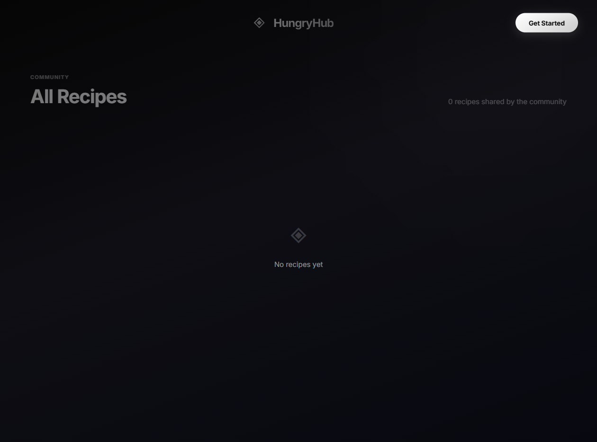

# HungryHub

HungryHub is a recipe discovery platform for finding, sharing, and creating recipes with help from an AI chef.

## Screenshots

### Home


### Recipe discovery



### AI Chef


## Features

- Browse and search community recipes
- Create, edit, and share recipes with images
- Like recipes and manage a personal profile
- Generate recipe ideas from available ingredients with AI
- Nutrition-focused recipe views
- Admin tools for managing recipe content

## Tech Stack

- Frontend: React, Vite, React Router, Axios, GSAP
- Backend: Node.js, Express, MongoDB, Mongoose
- Image uploads: ImageKit
- AI recipe generation: Google Gemini

## Run Locally

### Backend

```bash
cd backend
npm install
npm start
```

### Frontend

```bash
cd frontend
npm install
npm run dev
```

Create a `backend/.env` file with the required database, authentication, ImageKit, and AI provider settings before starting the backend.
